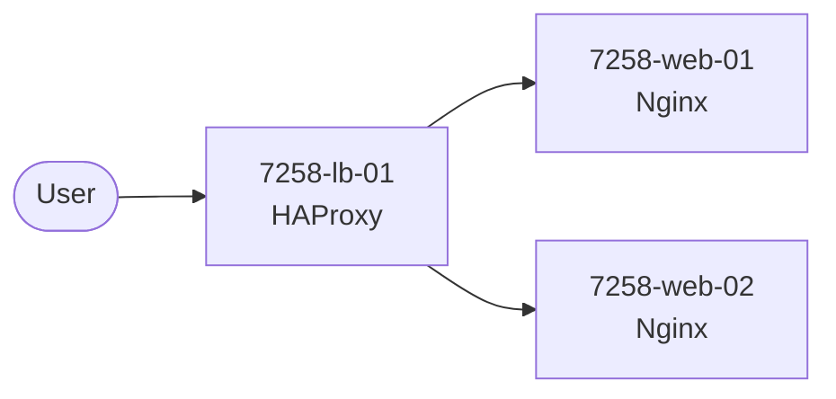

# alu-system_engineering-devops

System engineering and DevOps projects from the ALU curriculum.

## Projects

| Directory | Description |
| --------- | ----------- |
| [ssh](ssh) | Connecting to a remote server with SSH and key pairs |
| [web_server](web_server) | Transferring files with `scp`, installing and configuring Nginx |
| [load_balancer](load_balancer) | A second Nginx web server with an `X-Served-By` header, behind an HAProxy roundrobin load balancer |

## Servers

