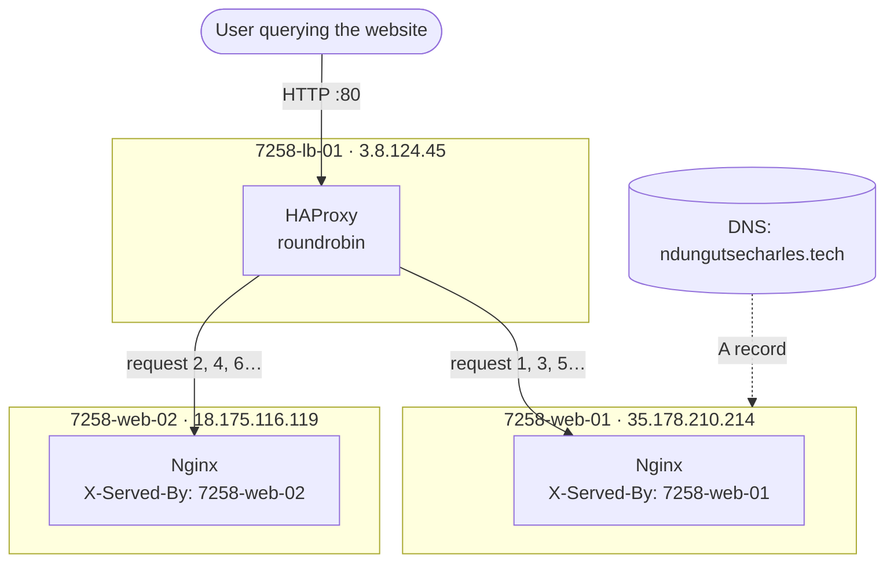

# Load balancer

Doubling the number of web servers and putting an HAProxy load balancer in
front of them, so traffic is shared between web-01 and web-02.

## Infrastructure



The same layout as plain text:

```
                     User querying the website
                                |
                                v  HTTP :80
                   +---------------------------+
                   |  7258-lb-01  3.8.124.45   |
                   |  HAProxy (roundrobin)     |
                   +---------------------------+
                      |                     |
                      v                     v
   +---------------------------+   +---------------------------+
   | 7258-web-01               |   | 7258-web-02               |
   | 35.178.210.214            |   | 18.175.116.119            |
   | Nginx                     |   | Nginx                     |
   | X-Served-By: 7258-web-01  |   | X-Served-By: 7258-web-02  |
   +---------------------------+   +---------------------------+
```

The `X-Served-By` header tells which web server answered a request, which
makes the roundrobin distribution visible.

## Tasks

| File | Description |
| ---- | ----------- |
| [0-custom_http_response_header](0-custom_http_response_header) | Configures a new Ubuntu machine like web-01 (Nginx, index page, `/redirect_me`, custom 404) and adds an `X-Served-By` response header holding the server's hostname |
| [1-install_load_balancer](1-install_load_balancer) | Installs HAProxy, enables its init script (`ENABLED=1`) and sends HTTP traffic to web-01 and web-02 using `roundrobin` |

## Usage

Run each script on its server, as root:

```bash
# on web-01 and web-02
sudo ./0-custom_http_response_header
# on lb-01
sudo ./1-install_load_balancer
```

Check the distribution from any machine:

```bash
$ for i in 1 2 3 4; do curl -sI 3.8.124.45 | grep X-Served-By; done
X-Served-By: 7258-web-01
X-Served-By: 7258-web-02
X-Served-By: 7258-web-01
X-Served-By: 7258-web-02
```

## Notes

- HAProxy 2.x lowercases response header names. `h1-case-adjust` restores
  `X-Served-By` so clients see the same name that Nginx sends.
- The scripts are idempotent: running them again does not duplicate configuration.
